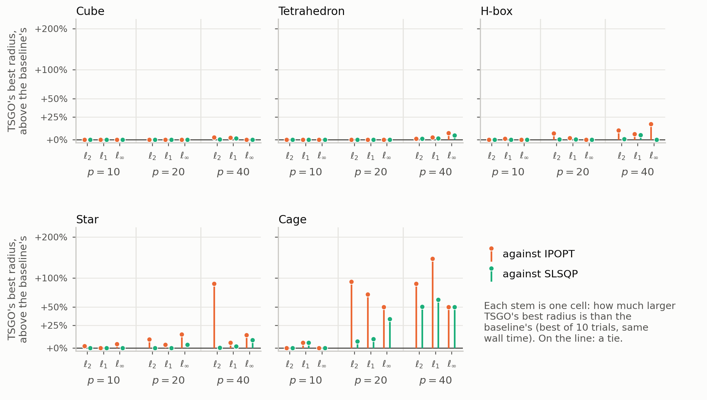
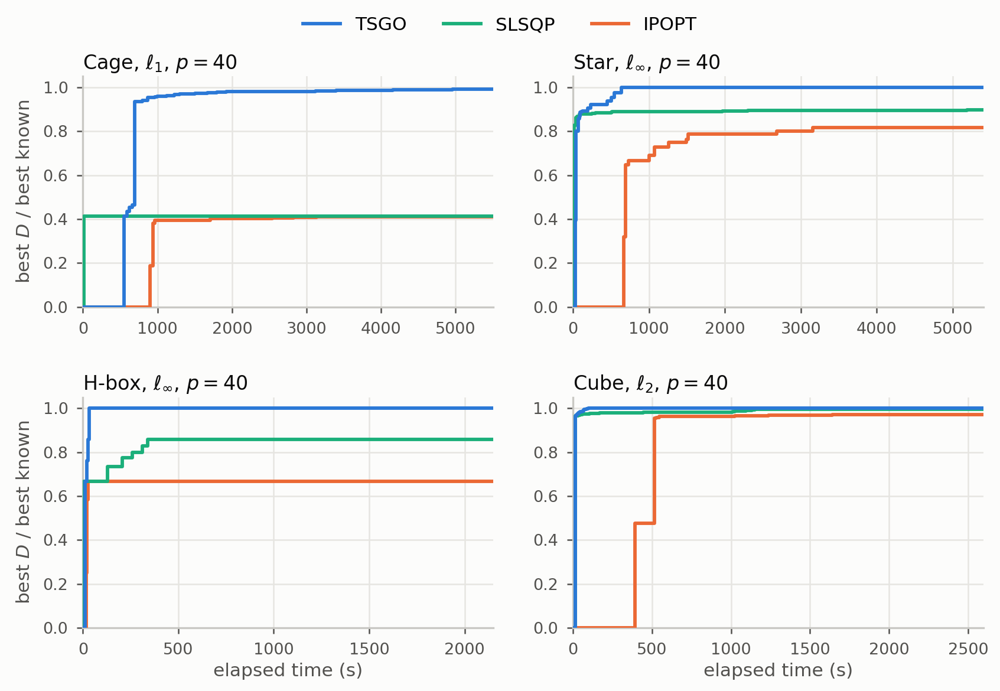
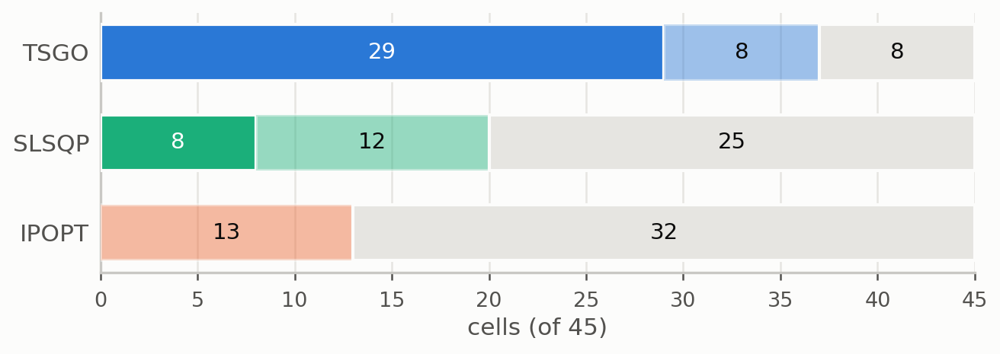

# Continuous p-dispersion: cluster results suite

Solver commit `0312aab`, every run with the escape phase on (factor 1.02, 15-min phase limit), one core per run on IllinoisComputes (AMD EPYC 7713). Built by `slurm/submit_all.sh`; regenerate this page with `python slurm/make_report.py`.
"Previous" is each cell's best radius as published before this suite (commit `f76300c`, Apple M2 Pro, escape phase off). `D` is the radius throughout.

## 1. Runs

| study | cells | runs | feasible | core_hours | median_wall_s | max_wall_s | runs_past_30_min |
|---|---|---|---|---|---|---|---|
| Main grid | 240 | 4800 | 4800 | 1208.2 | 360.5 | 9874.0 | 1098 |
| H-box, l-inf, p = 56 | 1 | 20 | 20 | 7.0 | 988.1 | 1935.6 | 2 |
| Stoyan & Yaskov | 120 | 1200 | 1200 | 858.5 | 2708.4 | 8418.9 | 1033 |
| Stoyan & Yaskov, extension | 9 | 90 | 90 | 67.8 | 2709.6 | 2728.5 | 90 |

## 2. Feasibility, numerical stability and timing

Every final configuration is re-certified by `supplement/verify_packing.py`, the standalone checker that shares no code with the solver: `verify_margin` is (r - D) / D, where r is the radius it recomputes from the centres alone; the solver reports D = B(X)(1 - 1e-9), so the margin should sit at +1e-9. Per cell: `supplement/tables/cell_summary.csv`.

| study | cells | runs | infeasible | fallback_runs | verify_fail | verify_margin_min | energy_max | monotone_violations | runs_over_50min | wall_max_s | core_hours |
|---|---|---|---|---|---|---|---|---|---|---|---|
| h-box-linf-56 | 1 | 20 | 0 | 0 | 0 | 1e-09 | 0 | 0 | 0 | 1.94e+03 | 7 |
| main | 240 | 4800 | 0 | 36 | 0 | 1e-09 | 0 | 0 | 37 | 9.87e+03 | 1.21e+03 |
| stoyan-yaskov | 120 | 1200 | 0 | 3 | 0 | 1e-09 | 0 | 11 | 65 | 8.42e+03 | 858 |
| stoyan-yaskov-ext | 9 | 90 | 0 | 0 | 0 | 1e-09 | 0 | 0 | 0 | 2.73e+03 | 67.8 |

Cells whose best radius exceeds that of a smaller p in the same series (impossible at the optimum, so the smaller p is under-searched):

| study | container | metric | p | D_best |
|---|---|---|---|---|
| stoyan-yaskov | stoyan-yaskov-1 | EUCLIDEAN | 96 | 1.002410 |
| stoyan-yaskov | stoyan-yaskov-1 | TAXICAB | 94 | 1.355498 |
| stoyan-yaskov | stoyan-yaskov-2 | EUCLIDEAN | 94 | 0.999402 |
| stoyan-yaskov | stoyan-yaskov-2 | EUCLIDEAN | 95 | 0.999275 |
| stoyan-yaskov | stoyan-yaskov-3 | SUP_NORM | 87 | 0.861760 |
| stoyan-yaskov | stoyan-yaskov-4 | SUP_NORM | 83 | 0.845599 |
| stoyan-yaskov | stoyan-yaskov-4 | TAXICAB | 82 | 1.313547 |
| stoyan-yaskov | stoyan-yaskov-4 | TAXICAB | 84 | 1.296544 |
| stoyan-yaskov | stoyan-yaskov-5 | SUP_NORM | 81 | 0.837504 |
| stoyan-yaskov | stoyan-yaskov-5 | SUP_NORM | 83 | 0.827714 |
| stoyan-yaskov | stoyan-yaskov-5 | TAXICAB | 82 | 1.279101 |

Slowest cells. A run over 50 minutes is one whose first start, which has no deadline, ran long: seeds on the two top rungs of the D_init ladder start above the optimum, and Tabu Search there runs its full patience.

| study | container | metric | p | runs_over_50min | wall_median_s | wall_max_s |
|---|---|---|---|---|---|---|
| main | cage | SUP_NORM | 100 | 8 | 2729 | 9874 |
| main | cage | TAXICAB | 100 | 7 | 2734 | 8686 |
| stoyan-yaskov | stoyan-yaskov-5 | TAXICAB | 81 | 4 | 2843 | 8419 |
| stoyan-yaskov | stoyan-yaskov-5 | TAXICAB | 80 | 4 | 2816 | 7762 |
| stoyan-yaskov | stoyan-yaskov-5 | TAXICAB | 82 | 4 | 2814 | 6248 |
| main | cage | EUCLIDEAN | 100 | 6 | 2677 | 6046 |
| stoyan-yaskov | stoyan-yaskov-5 | SUP_NORM | 83 | 2 | 2721 | 5746 |
| stoyan-yaskov | stoyan-yaskov-4 | TAXICAB | 83 | 4 | 2798 | 5405 |
| stoyan-yaskov | stoyan-yaskov-5 | SUP_NORM | 79 | 2 | 2719 | 5303 |
| stoyan-yaskov | stoyan-yaskov-5 | TAXICAB | 79 | 4 | 2862 | 5230 |

## 3. Main grid: best of 20 seeds

Against previous: higher in **10**, tied in **209**, lower in **21** of 240 cells (tie: within 1e-06 relative).

### cube, EUCLIDEAN

| p | best_D | median_D | prev_D | change_% | feasible_runs | mean_wall_s |
|---|---|---|---|---|---|---|
| 1 | 0.500000 | 0.500000 | 0.500000 | 0.000000 | 20 | 2 |
| 2 | 0.316987 | 0.316987 | 0.316987 | 0.000000 | 20 | 33 |
| 3 | 0.292893 | 0.292893 | 0.292893 | 0.000000 | 20 | 55 |
| 4 | 0.292893 | 0.292893 | 0.292893 | 0.000000 | 20 | 79 |
| 5 | 0.263932 | 0.263932 | 0.263932 | -0.000000 | 20 | 128 |
| 6 | 0.257359 | 0.257359 | 0.257359 | -0.000000 | 20 | 176 |
| 7 | 0.250136 | 0.250125 | 0.250136 | 0.000000 | 20 | 203 |
| 8 | 0.250000 | 0.250000 | 0.250000 | 0.000000 | 20 | 97 |
| 9 | 0.232051 | 0.232051 | 0.232051 | 0.000000 | 20 | 164 |
| 10 | 0.214286 | 0.214286 | 0.214286 | -0.000000 | 20 | 230 |
| 20 | 0.178407 | 0.178407 | 0.178407 | -0.000000 | 20 | 661 |
| 27 | 0.166667 | 0.166667 | 0.166667 | 0.000000 | 20 | 576 |
| 30 | 0.160189 | 0.160189 | 0.160189 | -0.000000 | 20 | 671 |
| 40 | 0.147059 | 0.147059 | 0.147059 | -0.000000 | 20 | 1348 |
| 50 | 0.135954 | 0.135950 | 0.135954 | 0.000030 | 20 | 2691 |
| 64 | 0.126743 | 0.126734 | 0.126743 | -0.000206 | 20 | 2704 |
| 100 | 0.111382 | 0.111382 | 0.111382 | -0.000000 | 20 | 2705 |

### cube, TAXICAB

| p | best_D | median_D | prev_D | change_% | feasible_runs | mean_wall_s |
|---|---|---|---|---|---|---|
| 1 | 0.500000 | 0.500000 | 0.500000 | 0.000000 | 20 | 3 |
| 2 | 0.375000 | 0.375000 | 0.375000 | 0.000000 | 20 | 23 |
| 3 | 0.333333 | 0.333333 | 0.333333 | 0.000000 | 20 | 63 |
| 4 | 0.333333 | 0.333333 | 0.333333 | 0.000000 | 20 | 90 |
| 5 | 0.300000 | 0.300000 | 0.300000 | 0.000000 | 20 | 121 |
| 6 | 0.300000 | 0.300000 | 0.300000 | 0.000000 | 20 | 149 |
| 7 | 0.285714 | 0.285714 | 0.285714 | 0.000000 | 20 | 183 |
| 8 | 0.272727 | 0.272727 | 0.272727 | 0.000000 | 20 | 241 |
| 9 | 0.269231 | 0.269231 | 0.269231 | 0.000000 | 20 | 392 |
| 10 | 0.260870 | 0.260870 | 0.260870 | 0.000000 | 20 | 342 |
| 20 | 0.222222 | 0.222222 | 0.222222 | 0.000000 | 20 | 1399 |
| 27 | 0.206897 | 0.206084 | 0.206897 | -0.000000 | 20 | 2147 |
| 30 | 0.200000 | 0.200000 | 0.200000 | 0.000000 | 20 | 1432 |
| 40 | 0.187500 | 0.187500 | 0.187500 | 0.000000 | 20 | 2702 |
| 50 | 0.176471 | 0.176471 | 0.176471 | 0.000000 | 20 | 2703 |
| 64 | 0.166667 | 0.166667 | 0.166667 | 0.000000 | 20 | 2704 |
| 100 | 0.146067 | 0.144831 | 0.145749 | 0.218477 | 20 | 2707 |

### cube, SUP_NORM

| p | best_D | median_D | prev_D | change_% | feasible_runs | mean_wall_s |
|---|---|---|---|---|---|---|
| 1 | 0.500000 | 0.500000 | 0.500000 | 0.000000 | 20 | 5 |
| 2 | 0.250000 | 0.250000 | 0.250000 | 0.000000 | 20 | 13 |
| 3 | 0.250000 | 0.250000 | 0.250000 | 0.000000 | 20 | 42 |
| 4 | 0.250000 | 0.250000 | 0.250000 | 0.000000 | 20 | 61 |
| 5 | 0.250000 | 0.250000 | 0.250000 | 0.000000 | 20 | 71 |
| 6 | 0.250000 | 0.250000 | 0.250000 | 0.000000 | 20 | 91 |
| 7 | 0.250000 | 0.250000 | 0.250000 | 0.000000 | 20 | 101 |
| 8 | 0.250000 | 0.250000 | 0.250000 | 0.000000 | 20 | 116 |
| 9 | 0.166667 | 0.166667 | 0.166667 | 0.000000 | 20 | 85 |
| 10 | 0.166667 | 0.166667 | 0.166667 | 0.000000 | 20 | 105 |
| 20 | 0.166667 | 0.166667 | 0.166667 | 0.000000 | 20 | 315 |
| 27 | 0.166667 | 0.166667 | 0.166667 | 0.000000 | 20 | 417 |
| 30 | 0.125000 | 0.125000 | 0.125000 | 0.000000 | 20 | 419 |
| 40 | 0.125000 | 0.125000 | 0.125000 | 0.000000 | 20 | 931 |
| 50 | 0.125000 | 0.125000 | 0.125000 | 0.000000 | 20 | 981 |
| 64 | 0.125000 | 0.125000 | 0.125000 | 0.000000 | 20 | 1055 |
| 100 | 0.100000 | 0.100000 | 0.100000 | 0.000000 | 20 | 1196 |

### tetrahedron, EUCLIDEAN

| p | best_D | median_D | prev_D | change_% | feasible_runs | mean_wall_s |
|---|---|---|---|---|---|---|
| 1 | 0.204124 | 0.204124 | 0.204124 | 0.000000 | 20 | 3 |
| 2 | 0.144949 | 0.144949 | 0.144949 | -0.000000 | 20 | 32 |
| 3 | 0.144949 | 0.144949 | 0.144949 | -0.000000 | 20 | 44 |
| 4 | 0.144949 | 0.144949 | 0.144949 | -0.000000 | 20 | 59 |
| 5 | 0.122474 | 0.122474 | 0.122474 | 0.000000 | 20 | 107 |
| 6 | 0.113871 | 0.113871 | 0.113871 | 0.000000 | 20 | 166 |
| 7 | 0.112372 | 0.112372 | 0.112372 | -0.000000 | 20 | 132 |
| 8 | 0.112372 | 0.112372 | 0.112372 | -0.000000 | 20 | 145 |
| 9 | 0.112372 | 0.112372 | 0.112372 | -0.000000 | 20 | 126 |
| 10 | 0.112372 | 0.112372 | 0.112372 | -0.000000 | 20 | 125 |
| 20 | 0.091752 | 0.091752 | 0.091752 | -0.000000 | 20 | 254 |
| 30 | 0.077526 | 0.077526 | 0.077526 | -0.000000 | 20 | 578 |
| 35 | 0.077526 | 0.077526 | 0.077526 | -0.000000 | 20 | 483 |
| 40 | 0.069754 | 0.069710 | 0.070263 | -0.723558 | 20 | 2260 |
| 50 | 0.067119 | 0.067119 | 0.067119 | -0.000000 | 20 | 997 |
| 56 | 0.067119 | 0.067119 | 0.067119 | -0.000000 | 20 | 823 |
| 84 | 0.059175 | 0.059175 | 0.059175 | -0.000000 | 20 | 1027 |
| 100 | 0.053273 | 0.052988 | 0.053302 | -0.054470 | 20 | 1266 |

### tetrahedron, TAXICAB

| p | best_D | median_D | prev_D | change_% | feasible_runs | mean_wall_s |
|---|---|---|---|---|---|---|
| 1 | 0.228339 | 0.228339 | 0.228339 | -0.000000 | 20 | 4 |
| 2 | 0.177765 | 0.177765 | 0.177765 | 0.000000 | 20 | 51 |
| 3 | 0.171257 | 0.171257 | 0.171257 | 0.000000 | 20 | 136 |
| 4 | 0.164064 | 0.164064 | 0.164064 | 0.000000 | 20 | 185 |
| 5 | 0.151059 | 0.151059 | 0.151059 | 0.000000 | 20 | 205 |
| 6 | 0.145531 | 0.145531 | 0.145531 | -0.000000 | 20 | 274 |
| 7 | 0.141140 | 0.141140 | 0.141140 | 0.000000 | 20 | 391 |
| 8 | 0.139059 | 0.139059 | 0.139059 | 0.000000 | 20 | 539 |
| 9 | 0.135842 | 0.135842 | 0.135842 | -0.000000 | 20 | 749 |
| 10 | 0.133132 | 0.133132 | 0.133132 | -0.000000 | 20 | 849 |
| 20 | 0.111762 | 0.111588 | 0.111762 | 0.000000 | 20 | 2103 |
| 30 | 0.100770 | 0.100573 | 0.100945 | -0.173184 | 20 | 2694 |
| 35 | 0.097061 | 0.096696 | 0.097061 | 0.000000 | 20 | 2703 |
| 40 | 0.093621 | 0.093145 | 0.093522 | 0.106197 | 20 | 2704 |
| 50 | 0.087896 | 0.087616 | 0.088248 | -0.399100 | 20 | 2704 |
| 56 | 0.085367 | 0.084992 | 0.085466 | -0.116378 | 20 | 2705 |
| 84 | 0.075930 | 0.075678 | 0.076329 | -0.522746 | 20 | 2707 |
| 100 | 0.072199 | 0.071924 | 0.072569 | -0.509524 | 20 | 2709 |

### tetrahedron, SUP_NORM

| p | best_D | median_D | prev_D | change_% | feasible_runs | mean_wall_s |
|---|---|---|---|---|---|---|
| 1 | 0.147953 | 0.147953 | 0.147953 | 0.000000 | 20 | 4 |
| 2 | 0.114170 | 0.114170 | 0.114170 | 0.000000 | 20 | 31 |
| 3 | 0.110274 | 0.110274 | 0.110274 | -0.000000 | 20 | 60 |
| 4 | 0.108597 | 0.108597 | 0.108597 | -0.000000 | 20 | 84 |
| 5 | 0.092946 | 0.092946 | 0.092946 | 0.000000 | 20 | 92 |
| 6 | 0.090348 | 0.090348 | 0.090348 | -0.000000 | 20 | 157 |
| 7 | 0.089219 | 0.089219 | 0.089219 | -0.000000 | 20 | 174 |
| 8 | 0.087891 | 0.087891 | 0.087891 | -0.000000 | 20 | 204 |
| 9 | 0.086822 | 0.086822 | 0.086822 | -0.000000 | 20 | 205 |
| 10 | 0.085779 | 0.085779 | 0.085779 | 0.000000 | 20 | 221 |
| 20 | 0.070885 | 0.070885 | 0.070885 | -0.000000 | 20 | 549 |
| 30 | 0.062514 | 0.062514 | 0.062514 | -0.000000 | 20 | 1882 |
| 35 | 0.060398 | 0.060398 | 0.060398 | 0.000000 | 20 | 1480 |
| 40 | 0.057085 | 0.057085 | 0.057085 | 0.000000 | 20 | 2567 |
| 50 | 0.054298 | 0.054212 | 0.054298 | 0.000000 | 20 | 2538 |
| 56 | 0.053005 | 0.053005 | 0.053005 | -0.000000 | 20 | 2523 |
| 84 | 0.047224 | 0.047151 | 0.047224 | -0.000000 | 20 | 2693 |
| 100 | 0.044275 | 0.043903 | 0.044275 | 0.000000 | 20 | 2704 |

### h-box, EUCLIDEAN

| p | best_D | median_D | prev_D | change_% | feasible_runs | mean_wall_s |
|---|---|---|---|---|---|---|
| 1 | 0.500000 | 0.500000 | 0.500000 | 0.000000 | 20 | 2 |
| 2 | 0.500000 | 0.500000 | 0.500000 | 0.000000 | 20 | 10 |
| 3 | 0.500000 | 0.500000 | 0.500000 | 0.000000 | 20 | 21 |
| 4 | 0.500000 | 0.500000 | 0.500000 | 0.000000 | 20 | 36 |
| 5 | 0.500000 | 0.500000 | 0.500000 | 0.000000 | 20 | 50 |
| 6 | 0.500000 | 0.500000 | 0.500000 | 0.000000 | 20 | 103 |
| 7 | 0.500000 | 0.500000 | 0.500000 | 0.000000 | 20 | 72 |
| 8 | 0.410936 | 0.410936 | 0.410936 | -0.000000 | 20 | 179 |
| 9 | 0.397258 | 0.397258 | 0.397258 | -0.000000 | 20 | 199 |
| 10 | 0.393609 | 0.393609 | 0.393609 | -0.000000 | 20 | 221 |
| 20 | 0.311418 | 0.311418 | 0.311418 | -0.000000 | 20 | 1537 |
| 30 | 0.292894 | 0.292893 | 0.292917 | -0.007823 | 20 | 1021 |
| 40 | 0.273907 | 0.273901 | 0.273907 | 0.000000 | 20 | 2544 |
| 50 | 0.255882 | 0.255858 | 0.255882 | 0.000000 | 20 | 2704 |
| 100 | 0.207107 | 0.206608 | 0.207107 | -0.000077 | 20 | 2707 |

### h-box, TAXICAB

| p | best_D | median_D | prev_D | change_% | feasible_runs | mean_wall_s |
|---|---|---|---|---|---|---|
| 1 | 0.500000 | 0.500000 | 0.500000 | 0.000000 | 20 | 2 |
| 2 | 0.500000 | 0.500000 | 0.500000 | 0.000000 | 20 | 11 |
| 3 | 0.500000 | 0.500000 | 0.500000 | 0.000000 | 20 | 23 |
| 4 | 0.500000 | 0.500000 | 0.500000 | 0.000000 | 20 | 42 |
| 5 | 0.500000 | 0.500000 | 0.500000 | 0.000000 | 20 | 64 |
| 6 | 0.500000 | 0.500000 | 0.500000 | 0.000000 | 20 | 112 |
| 7 | 0.500000 | 0.500000 | 0.500000 | 0.000000 | 20 | 149 |
| 8 | 0.468750 | 0.468750 | 0.468750 | -0.000000 | 20 | 225 |
| 9 | 0.461538 | 0.461538 | 0.461538 | 0.000000 | 20 | 215 |
| 10 | 0.458333 | 0.458333 | 0.458333 | 0.000000 | 20 | 258 |
| 20 | 0.381395 | 0.380952 | 0.380952 | 0.116279 | 20 | 1588 |
| 30 | 0.348624 | 0.347826 | 0.348624 | -0.000000 | 20 | 2689 |
| 40 | 0.333333 | 0.333333 | 0.333333 | 0.000000 | 20 | 2369 |
| 50 | 0.312500 | 0.312245 | 0.312500 | -0.000000 | 20 | 2703 |
| 100 | 0.259644 | 0.258621 | 0.260163 | -0.199369 | 20 | 2707 |

### h-box, SUP_NORM

| p | best_D | median_D | prev_D | change_% | feasible_runs | mean_wall_s |
|---|---|---|---|---|---|---|
| 1 | 0.500000 | 0.500000 | 0.500000 | 0.000000 | 20 | 5 |
| 2 | 0.500000 | 0.500000 | 0.500000 | 0.000000 | 20 | 29 |
| 3 | 0.500000 | 0.500000 | 0.500000 | 0.000000 | 20 | 58 |
| 4 | 0.500000 | 0.500000 | 0.500000 | 0.000000 | 20 | 86 |
| 5 | 0.500000 | 0.500000 | 0.500000 | 0.000000 | 20 | 110 |
| 6 | 0.500000 | 0.500000 | 0.500000 | 0.000000 | 20 | 159 |
| 7 | 0.500000 | 0.500000 | 0.500000 | 0.000000 | 20 | 177 |
| 8 | 0.375000 | 0.375000 | 0.375000 | 0.000000 | 20 | 138 |
| 9 | 0.375000 | 0.375000 | 0.375000 | 0.000000 | 20 | 153 |
| 10 | 0.375000 | 0.375000 | 0.375000 | 0.000000 | 20 | 172 |
| 20 | 0.250000 | 0.250000 | 0.250000 | 0.000000 | 20 | 450 |
| 30 | 0.250000 | 0.250000 | 0.250000 | 0.000000 | 20 | 996 |
| 40 | 0.250000 | 0.250000 | 0.250000 | 0.000000 | 20 | 1080 |
| 50 | 0.250000 | 0.250000 | 0.250000 | 0.000000 | 20 | 1216 |
| 100 | 0.166667 | 0.166667 | 0.166667 | 0.000000 | 20 | 1755 |

### pointy-star, EUCLIDEAN

| p | best_D | median_D | prev_D | change_% | feasible_runs | mean_wall_s |
|---|---|---|---|---|---|---|
| 1 | 1.414214 | 1.414214 | 1.414214 | 0.000000 | 20 | 11 |
| 2 | 0.975971 | 0.975971 | 0.975971 | 0.000000 | 20 | 61 |
| 3 | 0.902964 | 0.902964 | 0.902964 | 0.000000 | 20 | 104 |
| 4 | 0.902964 | 0.902964 | 0.902964 | 0.000000 | 20 | 150 |
| 5 | 0.902964 | 0.902964 | 0.902964 | 0.000000 | 20 | 156 |
| 6 | 0.902964 | 0.902964 | 0.902964 | 0.000000 | 20 | 203 |
| 7 | 0.816579 | 0.816579 | 0.816579 | -0.000000 | 20 | 258 |
| 8 | 0.766143 | 0.766143 | 0.766143 | 0.000000 | 20 | 384 |
| 9 | 0.723372 | 0.723372 | 0.723372 | 0.000000 | 20 | 446 |
| 10 | 0.707107 | 0.707107 | 0.707107 | -0.000000 | 20 | 504 |
| 20 | 0.585673 | 0.585673 | 0.585673 | 0.000000 | 20 | 1653 |
| 30 | 0.513396 | 0.513396 | 0.513396 | 0.000000 | 20 | 2704 |
| 40 | 0.475577 | 0.475328 | 0.475577 | -0.000000 | 20 | 2704 |
| 50 | 0.446415 | 0.445374 | 0.446412 | 0.000628 | 20 | 2706 |
| 100 | 0.362140 | 0.361453 | 0.362197 | -0.015750 | 20 | 2710 |

### pointy-star, TAXICAB

| p | best_D | median_D | prev_D | change_% | feasible_runs | mean_wall_s |
|---|---|---|---|---|---|---|
| 1 | 2.000000 | 2.000000 | 2.000000 | 0.000000 | 20 | 16 |
| 2 | 1.200000 | 1.200000 | 1.200000 | 0.000000 | 20 | 93 |
| 3 | 1.066667 | 1.066667 | 1.066667 | 0.000000 | 20 | 175 |
| 4 | 1.019608 | 1.019608 | 1.019608 | 0.000000 | 20 | 322 |
| 5 | 1.000000 | 1.000000 | 1.000000 | 0.000000 | 20 | 332 |
| 6 | 1.000000 | 1.000000 | 1.000000 | 0.000000 | 20 | 379 |
| 7 | 0.952381 | 0.952381 | 0.952381 | 0.000000 | 20 | 449 |
| 8 | 0.933333 | 0.933333 | 0.933333 | 0.000000 | 20 | 653 |
| 9 | 0.923077 | 0.923077 | 0.923077 | 0.000000 | 20 | 593 |
| 10 | 0.923077 | 0.923077 | 0.923077 | 0.000000 | 20 | 649 |
| 20 | 0.750000 | 0.750000 | 0.750000 | 0.000000 | 20 | 2425 |
| 30 | 0.666005 | 0.664978 | 0.666005 | 0.000000 | 20 | 2706 |
| 40 | 0.617977 | 0.615264 | 0.619314 | -0.215946 | 20 | 2708 |
| 50 | 0.584544 | 0.581314 | 0.586552 | -0.342449 | 20 | 2708 |
| 100 | 0.481096 | 0.477640 | 0.482053 | -0.198674 | 20 | 2831 |

### pointy-star, SUP_NORM

| p | best_D | median_D | prev_D | change_% | feasible_runs | mean_wall_s |
|---|---|---|---|---|---|---|
| 1 | 1.000000 | 1.000000 | 1.000000 | 0.000000 | 20 | 11 |
| 2 | 0.833333 | 0.833333 | 0.833333 | 0.000000 | 20 | 82 |
| 3 | 0.735294 | 0.735294 | 0.735294 | 0.000000 | 20 | 179 |
| 4 | 0.719178 | 0.719178 | 0.719178 | 0.000000 | 20 | 295 |
| 5 | 0.714286 | 0.714286 | 0.714286 | -0.000000 | 20 | 311 |
| 6 | 0.714286 | 0.714286 | 0.714286 | -0.000000 | 20 | 308 |
| 7 | 0.714286 | 0.714286 | 0.714286 | -0.000000 | 20 | 393 |
| 8 | 0.625000 | 0.625000 | 0.625000 | 0.000000 | 20 | 571 |
| 9 | 0.595238 | 0.595238 | 0.595238 | 0.000000 | 20 | 612 |
| 10 | 0.589888 | 0.589888 | 0.589888 | 0.000000 | 20 | 693 |
| 20 | 0.500000 | 0.500000 | 0.500000 | 0.000000 | 20 | 1311 |
| 30 | 0.419355 | 0.416667 | 0.423729 | -1.032258 | 20 | 1668 |
| 40 | 0.416667 | 0.416667 | 0.416667 | 0.000000 | 20 | 2496 |
| 50 | 0.384615 | 0.373134 | 0.384615 | 0.000000 | 20 | 2708 |
| 100 | 0.307018 | 0.294118 | 0.306604 | 0.134953 | 20 | 2962 |

### cage, EUCLIDEAN

| p | best_D | median_D | prev_D | change_% | feasible_runs | mean_wall_s |
|---|---|---|---|---|---|---|
| 1 | 1.581139 | 1.581139 | 1.581139 | -0.000000 | 20 | 9 |
| 2 | 1.581139 | 1.581139 | 1.581139 | -0.000000 | 20 | 58 |
| 3 | 1.581139 | 1.581139 | 1.581139 | -0.000000 | 20 | 161 |
| 4 | 1.581139 | 1.541667 | 1.541667 | 2.560357 | 20 | 198 |
| 5 | 1.541667 | 1.541667 | 1.541667 | 0.000000 | 20 | 291 |
| 6 | 1.541667 | 1.541667 | 1.541667 | 0.000000 | 20 | 510 |
| 7 | 1.500000 | 1.500000 | 1.500000 | 0.000000 | 20 | 522 |
| 8 | 1.500000 | 1.500000 | 1.500000 | 0.000000 | 20 | 660 |
| 9 | 1.456684 | 1.456684 | 1.456684 | 0.000000 | 20 | 851 |
| 10 | 1.456684 | 1.456684 | 1.456684 | 0.000000 | 20 | 1549 |
| 20 | 1.129421 | 1.129421 | 1.129421 | -0.000000 | 20 | 2511 |
| 30 | 1.000000 | 1.000000 | 1.000000 | 0.000000 | 20 | 2479 |
| 40 | 0.941635 | 0.938054 | 0.942458 | -0.087340 | 20 | 2511 |
| 50 | 0.888874 | 0.884438 | 0.889706 | -0.093418 | 20 | 1884 |
| 100 | 0.740802 | 0.732645 | 0.741756 | -0.128511 | 20 | 2469 |

### cage, TAXICAB

| p | best_D | median_D | prev_D | change_% | feasible_runs | mean_wall_s |
|---|---|---|---|---|---|---|
| 1 | 2.000000 | 2.000000 | 2.000000 | 0.000000 | 20 | 10 |
| 2 | 2.000000 | 2.000000 | 2.000000 | 0.000000 | 20 | 75 |
| 3 | 2.000000 | 2.000000 | 2.000000 | 0.000000 | 20 | 160 |
| 4 | 2.000000 | 2.000000 | 1.833333 | 9.090909 | 20 | 303 |
| 5 | 1.833333 | 1.833333 | 1.833333 | 0.000000 | 20 | 373 |
| 6 | 1.750000 | 1.750000 | 1.750000 | 0.000000 | 20 | 404 |
| 7 | 1.642857 | 1.642857 | 1.642857 | -0.000000 | 20 | 540 |
| 8 | 1.613636 | 1.583333 | 1.583333 | 1.913876 | 20 | 689 |
| 9 | 1.583333 | 1.583333 | 1.583333 | 0.000000 | 20 | 838 |
| 10 | 1.583333 | 1.581667 | 1.500000 | 5.555556 | 20 | 975 |
| 20 | 1.420000 | 1.416667 | 1.421053 | -0.074074 | 20 | 2705 |
| 30 | 1.307692 | 1.296148 | 1.309524 | -0.139860 | 20 | 2707 |
| 40 | 1.208333 | 1.188578 | 1.200000 | 0.694444 | 20 | 2717 |
| 50 | 1.142857 | 1.129101 | 1.142857 | -0.000000 | 20 | 2713 |
| 100 | 0.949074 | 0.913665 | 0.951098 | -0.212778 | 20 | 3462 |

### cage, SUP_NORM

| p | best_D | median_D | prev_D | change_% | feasible_runs | mean_wall_s |
|---|---|---|---|---|---|---|
| 1 | 1.500000 | 1.500000 | 1.500000 | 0.000000 | 20 | 8 |
| 2 | 1.500000 | 1.500000 | 1.500000 | 0.000000 | 20 | 67 |
| 3 | 1.500000 | 1.500000 | 1.500000 | 0.000000 | 20 | 177 |
| 4 | 1.500000 | 1.500000 | 1.500000 | 0.000000 | 20 | 333 |
| 5 | 1.500000 | 1.500000 | 1.500000 | 0.000000 | 20 | 410 |
| 6 | 1.500000 | 1.500000 | 1.500000 | 0.000000 | 20 | 680 |
| 7 | 1.250000 | 1.250000 | 1.250000 | 0.000000 | 20 | 451 |
| 8 | 1.250000 | 1.250000 | 1.250000 | 0.000000 | 20 | 656 |
| 9 | 1.250000 | 1.250000 | 1.250000 | 0.000000 | 20 | 902 |
| 10 | 1.250000 | 1.250000 | 1.250000 | 0.000000 | 20 | 1007 |
| 20 | 1.000000 | 1.000000 | 1.000000 | 0.000000 | 20 | 1523 |
| 30 | 0.833333 | 0.833333 | 0.833333 | 0.000000 | 20 | 1812 |
| 40 | 0.750000 | 0.750000 | 0.750000 | 0.000000 | 20 | 2303 |
| 50 | 0.750000 | 0.750000 | 0.750000 | 0.000000 | 20 | 2563 |
| 100 | 0.666667 | 0.500000 | 0.666667 | 0.000000 | 20 | 4583 |

### Cells below the previous best

| container | metric | p | best_D | prev_D | change_% |
|---|---|---|---|---|---|
| pointy-star | SUP_NORM | 30 | 0.419355 | 0.423729 | -1.032258 |
| tetrahedron | EUCLIDEAN | 40 | 0.069754 | 0.070263 | -0.723558 |
| tetrahedron | TAXICAB | 84 | 0.075930 | 0.076329 | -0.522746 |
| tetrahedron | TAXICAB | 100 | 0.072199 | 0.072569 | -0.509524 |
| tetrahedron | TAXICAB | 50 | 0.087896 | 0.088248 | -0.399100 |
| pointy-star | TAXICAB | 50 | 0.584544 | 0.586552 | -0.342449 |
| pointy-star | TAXICAB | 40 | 0.617977 | 0.619314 | -0.215946 |
| cage | TAXICAB | 100 | 0.949074 | 0.951098 | -0.212778 |
| h-box | TAXICAB | 100 | 0.259644 | 0.260163 | -0.199369 |
| pointy-star | TAXICAB | 100 | 0.481096 | 0.482053 | -0.198674 |
| tetrahedron | TAXICAB | 30 | 0.100770 | 0.100945 | -0.173184 |
| cage | TAXICAB | 30 | 1.307692 | 1.309524 | -0.139860 |
| cage | EUCLIDEAN | 100 | 0.740802 | 0.741756 | -0.128511 |
| tetrahedron | TAXICAB | 56 | 0.085367 | 0.085466 | -0.116378 |
| cage | EUCLIDEAN | 50 | 0.888874 | 0.889706 | -0.093418 |
| cage | EUCLIDEAN | 40 | 0.941635 | 0.942458 | -0.087340 |
| cage | TAXICAB | 20 | 1.420000 | 1.421053 | -0.074074 |
| tetrahedron | EUCLIDEAN | 100 | 0.053273 | 0.053302 | -0.054470 |
| pointy-star | EUCLIDEAN | 100 | 0.362140 | 0.362197 | -0.015750 |
| h-box | EUCLIDEAN | 30 | 0.292894 | 0.292917 | -0.007823 |
| cube | EUCLIDEAN | 64 | 0.126743 | 0.126743 | -0.000206 |

## 4. H-box, l-inf, p = 56

| p | best_D | median_D | prev_D | change_% | feasible |
|---|---|---|---|---|---|
| 56 | 0.250000 | 0.250000 | 0.214286 | 16.666667 | 20 |

## 5. Stoyan & Yaskov

A count is fitted when a seed reaches radius >= 1. Against previous: higher in **35**, tied in **22**, lower in **72** of 129 cells (tie: within 1e-06 relative).

| container | metric | largest_count_fitted | with_extra_seeds |
|---|---|---|---|
| stoyan-yaskov-1 | EUCLIDEAN | 97 | 97 |
| stoyan-yaskov-1 | TAXICAB | 97 | 97 |
| stoyan-yaskov-2 | EUCLIDEAN | 92 | 95 |
| stoyan-yaskov-2 | TAXICAB | 95 | 95 |
| stoyan-yaskov-3 | EUCLIDEAN | 87 | 88 |
| stoyan-yaskov-3 | TAXICAB | 90 | 90 |
| stoyan-yaskov-4 | EUCLIDEAN | 82 | 82 |
| stoyan-yaskov-4 | TAXICAB | 85 | 85 |
| stoyan-yaskov-5 | EUCLIDEAN | 79 | 79 |
| stoyan-yaskov-5 | TAXICAB | 83 | 83 |
| stoyan-yaskov-6 | EUCLIDEAN | 31 | 31 |
| stoyan-yaskov-6 | TAXICAB | 34 | 34 |
| stoyan-yaskov-7 | EUCLIDEAN | 59 | 59 |
| stoyan-yaskov-7 | TAXICAB | 62 | 62 |
| stoyan-yaskov-8 | EUCLIDEAN | 80 | 81 |
| stoyan-yaskov-8 | TAXICAB | 77 | 77 |

Extra seeds (declared extension, same solver, `supplement/tables/stoyan_yaskov_extra.csv`): stoyan-yaskov-2 EUCLIDEAN p = 95, seeds 10-41: 3 of 32 reach radius >= 1, best 1.000565.

Extra seeds (declared extension, same solver, `supplement/tables/stoyan_yaskov_extra.csv`): stoyan-yaskov-3 EUCLIDEAN p = 88, seeds 10-41: 1 of 32 reach radius >= 1, best 1.000117.

Extra seeds (declared extension, same solver, `supplement/tables/stoyan_yaskov_extra.csv`): stoyan-yaskov-8 EUCLIDEAN p = 81, seeds 10-73: 3 of 64 reach radius >= 1, best 1.003401.

Extra seeds (declared extension, same solver, `supplement/tables/stoyan_yaskov_extra.csv`): stoyan-yaskov-8 EUCLIDEAN p = 82, seeds 10-41: 0 of 32 reach radius >= 1, best 0.999059.

| container | metric | p | best_D | prev_D | change_% | feasible |
|---|---|---|---|---|---|---|
| stoyan-yaskov-1 | EUCLIDEAN | 93 | 1.008147 | 1.006824 | 0.131366 | 10 |
| stoyan-yaskov-1 | EUCLIDEAN | 94 | 1.005719 | 1.005148 | 0.056855 | 10 |
| stoyan-yaskov-1 | EUCLIDEAN | 95 | 1.001978 | 1.005346 | -0.335022 | 10 |
| stoyan-yaskov-1 | EUCLIDEAN | 96 | 1.002410 | 1.003448 | -0.103434 | 10 |
| stoyan-yaskov-1 | EUCLIDEAN | 97 | 1.001192 | 1.001871 | -0.067710 | 10 |
| stoyan-yaskov-1 | EUCLIDEAN | 98 | 0.997786 | 0.997811 | -0.002546 | 10 |
| stoyan-yaskov-1 | EUCLIDEAN | 99 | 0.995217 | 0.995168 | 0.004844 | 10 |
| stoyan-yaskov-1 | EUCLIDEAN | 100 | 0.992634 | 0.992589 | 0.004491 | 10 |
| stoyan-yaskov-1 | SUP_NORM | 93 | 0.869167 | 0.869167 | 0.000000 | 10 |
| stoyan-yaskov-1 | SUP_NORM | 94 | 0.869167 | 0.869167 | 0.000000 | 10 |
| stoyan-yaskov-1 | SUP_NORM | 95 | 0.869167 | 0.869167 | -0.000000 | 10 |
| stoyan-yaskov-1 | SUP_NORM | 96 | 0.869167 | 0.869167 | -0.000000 | 10 |
| stoyan-yaskov-1 | SUP_NORM | 97 | 0.869167 | 0.869167 | -0.000000 | 10 |
| stoyan-yaskov-1 | TAXICAB | 93 | 1.351206 | 1.357809 | -0.486272 | 10 |
| stoyan-yaskov-1 | TAXICAB | 94 | 1.355498 | 1.352393 | 0.229630 | 10 |
| stoyan-yaskov-1 | TAXICAB | 95 | 1.342343 | 1.347875 | -0.410414 | 10 |
| stoyan-yaskov-1 | TAXICAB | 96 | 1.338967 | 1.342515 | -0.264241 | 10 |
| stoyan-yaskov-1 | TAXICAB | 97 | 1.333981 | 1.341725 | -0.577232 | 10 |
| stoyan-yaskov-2 | EUCLIDEAN | 91 | 1.006881 | 1.006917 | -0.003555 | 10 |
| stoyan-yaskov-2 | EUCLIDEAN | 92 | 1.003126 | 1.002974 | 0.015140 | 10 |
| stoyan-yaskov-2 | EUCLIDEAN | 93 | 0.998554 | 1.002158 | -0.359635 | 10 |
| stoyan-yaskov-2 | EUCLIDEAN | 94 | 0.999402 | 0.999525 | -0.012349 | 10 |
| stoyan-yaskov-2 | EUCLIDEAN | 95 | 0.999275 | 0.999211 | 0.006459 | 10 |
| stoyan-yaskov-2 | SUP_NORM | 91 | 0.869167 | 0.869167 | -0.000000 | 10 |
| stoyan-yaskov-2 | SUP_NORM | 92 | 0.869167 | 0.867673 | 0.172130 | 10 |
| stoyan-yaskov-2 | SUP_NORM | 93 | 0.869167 | 0.869167 | -0.000000 | 10 |
| stoyan-yaskov-2 | SUP_NORM | 94 | 0.867063 | 0.863092 | 0.460088 | 10 |
| stoyan-yaskov-2 | SUP_NORM | 95 | 0.860783 | 0.867284 | -0.749575 | 10 |
| stoyan-yaskov-2 | TAXICAB | 91 | 1.352978 | 1.357355 | -0.322447 | 10 |
| stoyan-yaskov-2 | TAXICAB | 92 | 1.350394 | 1.351988 | -0.117932 | 10 |
| stoyan-yaskov-2 | TAXICAB | 93 | 1.344648 | 1.348215 | -0.264590 | 10 |
| stoyan-yaskov-2 | TAXICAB | 94 | 1.337373 | 1.343041 | -0.422016 | 10 |
| stoyan-yaskov-2 | TAXICAB | 95 | 1.334778 | 1.338440 | -0.273612 | 10 |
| stoyan-yaskov-3 | EUCLIDEAN | 86 | 1.006651 | 1.006937 | -0.028467 | 10 |
| stoyan-yaskov-3 | EUCLIDEAN | 87 | 1.004476 | 1.004007 | 0.046675 | 10 |
| stoyan-yaskov-3 | EUCLIDEAN | 88 | 0.999934 | 1.000375 | -0.044120 | 10 |
| stoyan-yaskov-3 | EUCLIDEAN | 89 | 0.996683 | 0.996069 | 0.061694 | 10 |
| stoyan-yaskov-3 | EUCLIDEAN | 90 | 0.992228 | 0.992980 | -0.075719 | 10 |
| stoyan-yaskov-3 | SUP_NORM | 86 | 0.861407 | 0.864799 | -0.392165 | 10 |
| stoyan-yaskov-3 | SUP_NORM | 87 | 0.861760 | 0.861517 | 0.028254 | 10 |
| stoyan-yaskov-3 | SUP_NORM | 88 | 0.854429 | 0.856699 | -0.265021 | 10 |
| stoyan-yaskov-3 | SUP_NORM | 89 | 0.850277 | 0.848884 | 0.164049 | 10 |
| stoyan-yaskov-3 | SUP_NORM | 90 | 0.848448 | 0.831145 | 2.081810 | 10 |
| stoyan-yaskov-3 | TAXICAB | 86 | 1.305473 | 1.316667 | -0.850141 | 10 |
| stoyan-yaskov-3 | TAXICAB | 87 | 1.303770 | 1.313280 | -0.724158 | 10 |
| stoyan-yaskov-3 | TAXICAB | 88 | 1.298662 | 1.312193 | -1.031231 | 10 |
| stoyan-yaskov-3 | TAXICAB | 89 | 1.297373 | 1.304743 | -0.564859 | 10 |
| stoyan-yaskov-3 | TAXICAB | 90 | 1.293781 | 1.299867 | -0.468228 | 10 |
| stoyan-yaskov-4 | EUCLIDEAN | 81 | 1.005013 | 1.006519 | -0.149594 | 10 |
| stoyan-yaskov-4 | EUCLIDEAN | 82 | 1.002945 | 1.002912 | 0.003297 | 10 |
| stoyan-yaskov-4 | EUCLIDEAN | 83 | 0.997715 | 0.997715 | -0.000000 | 10 |
| stoyan-yaskov-4 | EUCLIDEAN | 84 | 0.994287 | 0.994294 | -0.000718 | 10 |
| stoyan-yaskov-4 | EUCLIDEAN | 85 | 0.991906 | 0.992003 | -0.009846 | 10 |
| stoyan-yaskov-4 | SUP_NORM | 81 | 0.843319 | 0.851877 | -1.004594 | 10 |
| stoyan-yaskov-4 | SUP_NORM | 82 | 0.837588 | 0.839728 | -0.254821 | 10 |
| stoyan-yaskov-4 | SUP_NORM | 83 | 0.845599 | 0.845423 | 0.020809 | 10 |
| stoyan-yaskov-4 | SUP_NORM | 84 | 0.824491 | 0.840473 | -1.901634 | 10 |
| stoyan-yaskov-4 | SUP_NORM | 85 | 0.819342 | 0.834202 | -1.781343 | 10 |
| stoyan-yaskov-4 | TAXICAB | 81 | 1.309763 | 1.318850 | -0.689018 | 10 |
| stoyan-yaskov-4 | TAXICAB | 82 | 1.313547 | 1.311828 | 0.131012 | 10 |
| stoyan-yaskov-4 | TAXICAB | 83 | 1.291429 | 1.315343 | -1.818139 | 10 |
| stoyan-yaskov-4 | TAXICAB | 84 | 1.296544 | 1.308611 | -0.922114 | 10 |
| stoyan-yaskov-4 | TAXICAB | 85 | 1.286659 | 1.307190 | -1.570618 | 10 |
| stoyan-yaskov-5 | EUCLIDEAN | 79 | 1.002798 | 1.004519 | -0.171330 | 10 |
| stoyan-yaskov-5 | EUCLIDEAN | 80 | 0.998680 | 0.999038 | -0.035835 | 10 |
| stoyan-yaskov-5 | EUCLIDEAN | 81 | 0.994250 | 0.994777 | -0.053032 | 10 |
| stoyan-yaskov-5 | EUCLIDEAN | 82 | 0.992450 | 0.992566 | -0.011712 | 10 |
| stoyan-yaskov-5 | EUCLIDEAN | 83 | 0.987546 | 0.987963 | -0.042227 | 10 |
| stoyan-yaskov-5 | SUP_NORM | 79 | 0.837692 | 0.846865 | -1.083133 | 10 |
| stoyan-yaskov-5 | SUP_NORM | 80 | 0.836470 | 0.844751 | -0.980263 | 10 |
| stoyan-yaskov-5 | SUP_NORM | 81 | 0.837504 | 0.837588 | -0.010103 | 10 |
| stoyan-yaskov-5 | SUP_NORM | 82 | 0.825858 | 0.843086 | -2.043468 | 10 |
| stoyan-yaskov-5 | SUP_NORM | 83 | 0.827714 | 0.833543 | -0.699408 | 10 |
| stoyan-yaskov-5 | TAXICAB | 79 | 1.284474 | 1.291571 | -0.549474 | 10 |
| stoyan-yaskov-5 | TAXICAB | 80 | 1.283854 | 1.293739 | -0.764105 | 10 |
| stoyan-yaskov-5 | TAXICAB | 81 | 1.275897 | 1.285309 | -0.732270 | 10 |
| stoyan-yaskov-5 | TAXICAB | 82 | 1.279101 | 1.291571 | -0.965535 | 10 |
| stoyan-yaskov-5 | TAXICAB | 83 | 1.271821 | 1.281467 | -0.752681 | 10 |
| stoyan-yaskov-6 | EUCLIDEAN | 30 | 1.007198 | 1.007205 | -0.000754 | 10 |
| stoyan-yaskov-6 | EUCLIDEAN | 31 | 1.001948 | 1.002217 | -0.026811 | 10 |
| stoyan-yaskov-6 | EUCLIDEAN | 32 | 0.994391 | 0.994305 | 0.008651 | 10 |
| stoyan-yaskov-6 | EUCLIDEAN | 33 | 0.988955 | 0.990422 | -0.148120 | 10 |
| stoyan-yaskov-6 | EUCLIDEAN | 34 | 0.984662 | 0.984662 | -0.000000 | 10 |
| stoyan-yaskov-6 | SUP_NORM | 30 | 0.892239 | 0.892239 | 0.000000 | 10 |
| stoyan-yaskov-6 | SUP_NORM | 31 | 0.870262 | 0.870262 | 0.000000 | 10 |
| stoyan-yaskov-6 | SUP_NORM | 32 | 0.870262 | 0.870262 | 0.000000 | 10 |
| stoyan-yaskov-6 | SUP_NORM | 33 | 0.870262 | 0.815947 | 6.656667 | 10 |
| stoyan-yaskov-6 | SUP_NORM | 34 | 0.870262 | 0.870262 | 0.000000 | 10 |
| stoyan-yaskov-6 | TAXICAB | 30 | 1.170378 | 1.172125 | -0.149063 | 10 |
| stoyan-yaskov-6 | TAXICAB | 31 | 1.166642 | 1.151341 | 1.328933 | 10 |
| stoyan-yaskov-6 | TAXICAB | 32 | 1.151341 | 1.151341 | -0.000000 | 10 |
| stoyan-yaskov-6 | TAXICAB | 33 | 1.151341 | 1.151341 | -0.000000 | 10 |
| stoyan-yaskov-6 | TAXICAB | 34 | 1.151341 | 1.151341 | -0.000000 | 10 |
| stoyan-yaskov-7 | EUCLIDEAN | 58 | 1.004568 | 1.005885 | -0.130993 | 10 |
| stoyan-yaskov-7 | EUCLIDEAN | 59 | 1.002340 | 1.002013 | 0.032609 | 10 |
| stoyan-yaskov-7 | EUCLIDEAN | 60 | 0.996223 | 0.996624 | -0.040242 | 10 |
| stoyan-yaskov-7 | EUCLIDEAN | 61 | 0.991851 | 0.992111 | -0.026170 | 10 |
| stoyan-yaskov-7 | EUCLIDEAN | 62 | 0.988859 | 0.988159 | 0.070903 | 10 |
| stoyan-yaskov-7 | SUP_NORM | 58 | 0.869167 | 0.869167 | 0.000000 | 10 |
| stoyan-yaskov-7 | SUP_NORM | 59 | 0.869167 | 0.869167 | 0.000000 | 10 |
| stoyan-yaskov-7 | SUP_NORM | 60 | 0.869167 | 0.860366 | 1.022878 | 10 |
| stoyan-yaskov-7 | SUP_NORM | 61 | 0.860366 | 0.860366 | 0.000000 | 10 |
| stoyan-yaskov-7 | SUP_NORM | 62 | 0.860366 | 0.826071 | 4.151625 | 10 |
| stoyan-yaskov-7 | TAXICAB | 58 | 1.257553 | 1.256927 | 0.049842 | 10 |
| stoyan-yaskov-7 | TAXICAB | 59 | 1.249687 | 1.249098 | 0.047135 | 10 |
| stoyan-yaskov-7 | TAXICAB | 60 | 1.238120 | 1.248041 | -0.794889 | 10 |
| stoyan-yaskov-7 | TAXICAB | 61 | 1.234684 | 1.241382 | -0.539526 | 10 |
| stoyan-yaskov-7 | TAXICAB | 62 | 1.230789 | 1.235849 | -0.409479 | 10 |
| stoyan-yaskov-8 | EUCLIDEAN | 73 | 1.032577 | 1.032577 | 0.000040 | 10 |
| stoyan-yaskov-8 | EUCLIDEAN | 74 | 1.026809 | 1.026878 | -0.006748 | 10 |
| stoyan-yaskov-8 | EUCLIDEAN | 75 | 1.021391 | 1.023035 | -0.160746 | 10 |
| stoyan-yaskov-8 | EUCLIDEAN | 76 | 1.019693 | 1.019091 | 0.059093 | 10 |
| stoyan-yaskov-8 | EUCLIDEAN | 77 | 1.014971 | 1.014278 | 0.068263 | 10 |
| stoyan-yaskov-8 | EUCLIDEAN | 78 | 1.010410 | 1.010252 | 0.015698 | 10 |
| stoyan-yaskov-8 | EUCLIDEAN | 79 | 1.006228 | 1.007559 | -0.132012 | 10 |
| stoyan-yaskov-8 | EUCLIDEAN | 80 | 1.003498 | 1.003517 | -0.001893 | 10 |
| stoyan-yaskov-8 | EUCLIDEAN | 81 | 0.999583 | 0.998689 | 0.089567 | 10 |
| stoyan-yaskov-8 | EUCLIDEAN | 82 | 0.997440 | 0.998276 | -0.083816 | 10 |
| stoyan-yaskov-8 | EUCLIDEAN | 83 | 0.993387 | 0.992351 | 0.104415 | 10 |
| stoyan-yaskov-8 | SUP_NORM | 73 | 0.887435 | 0.869167 | 2.101857 | 10 |
| stoyan-yaskov-8 | SUP_NORM | 74 | 0.887435 | 0.869167 | 2.101857 | 10 |
| stoyan-yaskov-8 | SUP_NORM | 75 | 0.887435 | 0.869167 | 2.101857 | 10 |
| stoyan-yaskov-8 | SUP_NORM | 76 | 0.869167 | 0.869167 | 0.000000 | 10 |
| stoyan-yaskov-8 | SUP_NORM | 77 | 0.869167 | 0.869167 | 0.000000 | 10 |
| stoyan-yaskov-8 | TAXICAB | 73 | 1.349559 | 1.349536 | 0.001731 | 10 |
| stoyan-yaskov-8 | TAXICAB | 74 | 1.342246 | 1.344720 | -0.183954 | 10 |
| stoyan-yaskov-8 | TAXICAB | 75 | 1.337530 | 1.341724 | -0.312550 | 10 |
| stoyan-yaskov-8 | TAXICAB | 76 | 1.333493 | 1.334892 | -0.104743 | 10 |
| stoyan-yaskov-8 | TAXICAB | 77 | 1.328317 | 1.333967 | -0.423548 | 10 |

## 6. Equal-budget benchmark

TSGO runs with the escape phase (budget_trial.py ESCAPE_FACTOR); IPOPT, SLSQP and Gurobi as in `paper/BASELINE_PROTOCOL.md`. Budgets per cell in `supplement/benchmark/budgets.csv`; per-cell plots in `supplement/benchmark/plots/`.

### Baseline comparison: results

Trials read: 1350 of 1350. Scored by what each trial completed within its budget.

#### B. Quality at equal wall time (best of 10, certified D)

| against | TSGO better | tied | TSGO worse | Wilcoxon p (two-sided) | median TSGO/baseline |
|---|---|---|---|---|---|
| ipopt | 30 | 15 | 0 | 5.7e-14 | 1.0190 |
| slsqp | 23 | 22 | 0 | 0.0009 | 1.0000 |

- convex (cube, tetrahedron): vs ipopt: 7 better / 11 tied / 0 worse; vs slsqp: 7 better / 11 tied / 0 worse
- non-convex (h-box, star, cage): vs ipopt: 23 better / 4 tied / 0 worse; vs slsqp: 16 better / 11 tied / 0 worse

#### A. Time to target

| target | solver | cells where most trials reach it | median of per-cell median time (s) |
|---|---|---|---|
| 99.0% | tsgo | 45 of 45 | 42.5 |
| 99.0% | ipopt | 18 of 45 | 88.7 |
| 99.0% | slsqp | 25 of 45 | 27.7 |
| 99.9% | tsgo | 37 of 45 | 36.3 |
| 99.9% | ipopt | 13 of 45 | 20.0 |
| 99.9% | slsqp | 20 of 45 | 17.6 |

Performance profile at the 99.9% target: share of cells a solver reaches within tau times the fastest solver's median time.

| solver | tau=1 | tau=2 | tau=10 | ever |
|---|---|---|---|---|
| tsgo | 64% | 69% | 80% | 82% |
| ipopt | 0% | 4% | 20% | 29% |
| slsqp | 18% | 27% | 38% | 44% |

#### E. Feasibility of reported radii (converged local solves)

| solver | converged solves | over-stated by >1e-6 | over-stated by >1% | certified radius zero | worst over-statement |
|---|---|---|---|---|---|
| ipopt | 259656 | 17.4% | 0.0% | 0.0% | 50.00% |
| slsqp | 2431797 | 41.8% | 1.0% | 1.1% | 100.00% |

## 7. Gurobi optimality certificates (l2, convex containers)

| container | p | status | tsgo_best | gurobi_incumbent | gurobi_bound | gap_tsgo_to_bound | wall_s | time_limit_s |
|---|---|---|---|---|---|---|---|---|
| cube | 1 | optimal | 0.5 | 0.5 | 0.5 | 1e-09 | 0.2 | 3600 |
| cube | 2 | optimal | 0.317 | 0.317 | 0.317 | 9.993e-10 | 0.5 | 3600 |
| cube | 3 | optimal | 0.2929 | 0.2929 | 0.2929 | 1.44e-09 | 0.7 | 3600 |
| cube | 4 | optimal | 0.2929 | 0.2929 | 0.2929 | 1.44e-09 | 0.7 | 3600 |
| cube | 5 | optimal | 0.2639 | 0.2639 | 0.2639 | 1.48e-09 | 2 | 3600 |
| cube | 6 | optimal | 0.2574 | 0.2574 | 0.2574 | 6.58e-07 | 8.2 | 3600 |
| cube | 7 | optimal | 0.2501 | 0.2501 | 0.2501 | 2.04e-06 | 877.4 | 3600 |
| cube | 8 | optimal | 0.25 | 0.25 | 0.25 | 1.5e-09 | 23 | 3600 |
| cube | 9 | optimal | 0.2321 | 0.2321 | 0.2321 | 5.385e-10 | 155.3 | 3600 |
| cube | 10 | time_limit | 0.2143 | 0.2143 | 0.27 | 0.2064 | 3600 | 3600 |
| cube | 20 | time_limit | 0.1784 | 0.1784 | 0.3332 | 0.4645 | 3600 | 3600 |
| tetrahedron | 1 | optimal | 0.2041 | 0.2041 | 0.2041 | 9.991e-10 | 0.2 | 3600 |
| tetrahedron | 2 | optimal | 0.1449 | 0.1449 | 0.1449 | 1.842e-06 | 0.6 | 3600 |
| tetrahedron | 3 | optimal | 0.1449 | 0.1449 | 0.1449 | 5.74e-07 | 0.9 | 3600 |
| tetrahedron | 4 | optimal | 0.1449 | 0.1449 | 0.1449 | 1.792e-09 | 0.7 | 3600 |
| tetrahedron | 5 | optimal | 0.1225 | 0.1225 | 0.1225 | 7.095e-06 | 2.7 | 3600 |
| tetrahedron | 6 | optimal | 0.1139 | 0.1139 | 0.1139 | 1.03e-05 | 86.8 | 3600 |
| tetrahedron | 7 | optimal | 0.1124 | 0.1124 | 0.1124 | 1.186e-05 | 425.5 | 3600 |
| tetrahedron | 8 | optimal | 0.1124 | 0.1124 | 0.1124 | 9.147e-06 | 1119 | 3600 |
| tetrahedron | 9 | optimal | 0.1124 | 0.1124 | 0.1124 | 7.027e-06 | 1845 | 3600 |
| tetrahedron | 10 | optimal | 0.1124 | 0.1124 | 0.1124 | 5.686e-06 | 2866 | 3600 |
| tetrahedron | 20 | time_limit | 0.09175 | 0.09175 | 0.1483 | 0.3813 | 3600 | 3600 |

## 8. Figures

In `supplement/figures/`, built with the manuscript's figure code from these results (paper/ is untouched):

- [baseline_anytime.png](figures/baseline_anytime.png)
- [baseline_outcomes.png](figures/baseline_outcomes.png)
- [baseline_quality.png](figures/baseline_quality.png)
- [baseline_reach.png](figures/baseline_reach.png)
- [cage_100.png](figures/cage_100.png)
- [cage_sup_100.png](figures/cage_sup_100.png)
- [comparison_cube.png](figures/comparison_cube.png)
- [comparison_tetrahedron.png](figures/comparison_tetrahedron.png)
- [cube_10.png](figures/cube_10.png)
- [cube_sup_64.png](figures/cube_sup_64.png)
- [h-box_sup_50.png](figures/h-box_sup_50.png)
- [h-box_sup_56.png](figures/h-box_sup_56.png)
- [kazakov_same_radius_10.png](figures/kazakov_same_radius_10.png)
- [ps_100.png](figures/ps_100.png)
- [runtime_euclidean.png](figures/runtime_euclidean.png)
- [runtime_sup_norm.png](figures/runtime_sup_norm.png)
- [runtime_taxicab.png](figures/runtime_taxicab.png)
- [stoyan_yaskov.png](figures/stoyan_yaskov.png)
- [stoyan_yaskov_packings.png](figures/stoyan_yaskov_packings.png)
- [tetra_10.png](figures/tetra_10.png)
- [tetra_l1_35.png](figures/tetra_l1_35.png)
- [tetra_l2_35.png](figures/tetra_l2_35.png)
- [tetra_linf_35.png](figures/tetra_linf_35.png)
